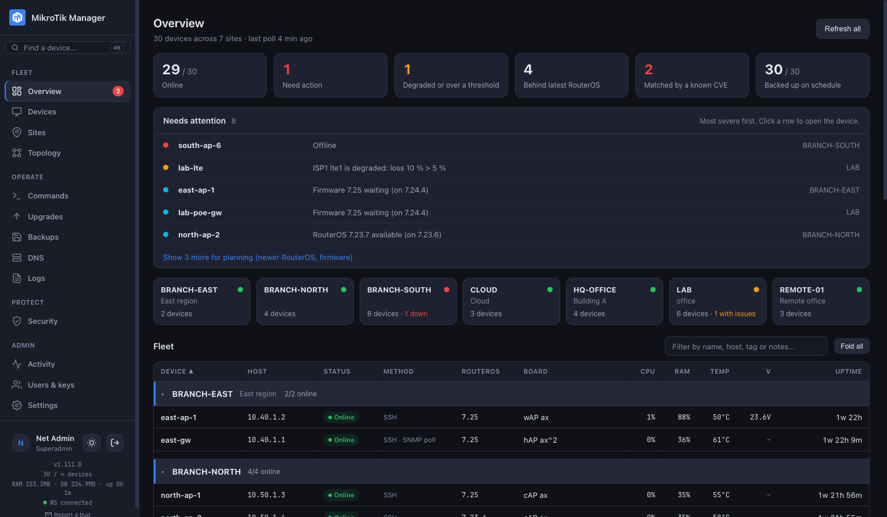
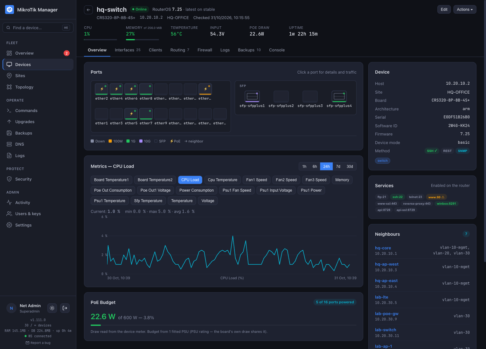
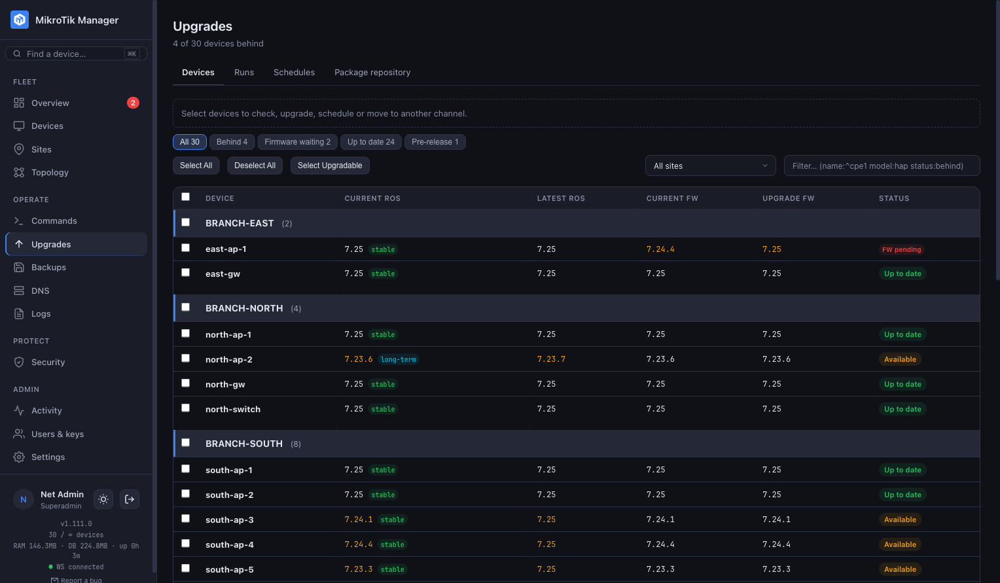
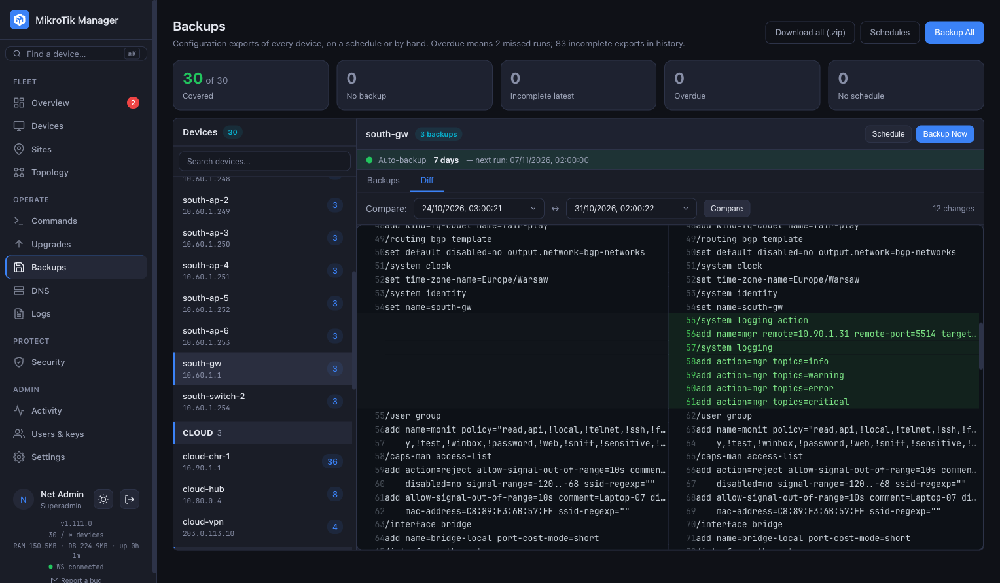
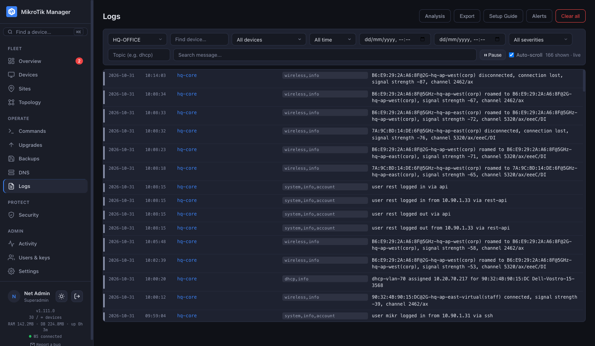

# MikroTik Manager

Self-hosted web application for running a fleet of MikroTik routers and switches. Monitor, upgrade, back up and configure them from one place, in a single Docker container on your own server. No account and no telemetry: your fleet data stays with you.

[](https://github.com/hreskiv/mikr/releases)
[](https://ghcr.io/hreskiv/mikr)

<p align="center">
  
</p>

<details>
<summary>More screenshots</summary>

<p align="center">
  
</p>

<p align="center">
  
</p>

<p align="center">
  
</p>

<p align="center">
  
</p>

</details>

## What it does

- **Monitoring** over SSH, REST or SNMP, with metric, traffic and SFP history and alerts on thresholds
- **RouterOS and firmware upgrades** across the fleet, with a queue, schedules, release notes and a safety stop
- **Config backups** on a schedule, with a diff between any two dates
- **Logs** from a built-in syslog receiver, with filters, export and alerts
- **Device pages** for interfaces, VLANs, PoE, Wi-Fi, LTE, tunnels, routing and the bridge tables
- **Topology map** built from neighbour discovery
- **Security**: RouterOS CVE matching, vendor patch tracking, auto-block of repeated failed logins
- **Integrations**: webhooks, Prometheus, Zabbix, and a read-only MCP endpoint
- **Access control**: four roles, per-site scope, TOTP and passkeys

Managed devices need RouterOS 7. RouterOS 6 is not supported.

## Quick start

```bash
mkdir -p /opt/mikr && cd /opt/mikr

cat > docker-compose.yml << 'EOF'
services:
  mikr:
    image: ghcr.io/hreskiv/mikr:latest
    container_name: mikr-manager
    restart: unless-stopped
    ports:
      - "3000:3000"
      - "5514:5514/udp"   # syslog, optional
      - "5514:5514/tcp"   # syslog, optional
    volumes:
      - ./data:/app/data
EOF

docker compose up -d
```

Open `http://<host>:3000` and sign in as **admin** / **admin**. The first sign-in asks for a new password.

The [installation guide](https://mikr.app/docs/installation.html) covers HTTPS, environment variables, IPv6, running on a MikroTik container, updating and going back a version. [Getting started](https://mikr.app/docs/getting-started.html) shows how to set up a dedicated RouterOS account for the manager and add your first devices.

## Documentation

Everything is at **[mikr.app/docs](https://mikr.app/docs/)**. How data is stored and what leaves the server is in the [security whitepaper](https://mikr.app/security.html). What's coming next is on the [roadmap](https://mikr.app/roadmap.html).

## Licensing

Community is free for up to 10 devices. Paid licenses raise the device limit, and every tier has every feature. Prices are on [mikr.app](https://mikr.app/#pricing), terms in the [EULA](https://mikr.app/eula.html).

## Feedback

Found a bug: open an [issue](https://github.com/hreskiv/mikr/issues). Questions and ideas: [Discussions](https://github.com/hreskiv/mikr/discussions). Inside the app, **Report a bug** at the bottom of the sidebar sends a report straight to me.
